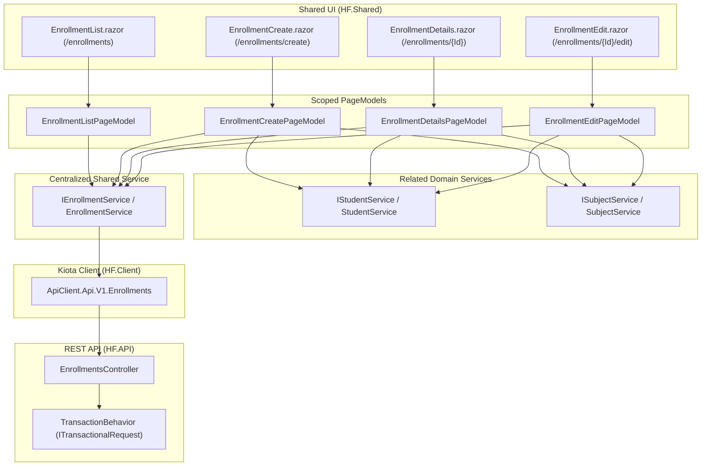

# Traceability and UI Coverage Matrix - Enrollments Feature

This document provides the endpoint-by-endpoint traceability matrix and architectural coverage for the **Enrollments** feature in *Horizon – Olhar do Futuro*, adhering to offline-first and single-tenant NGO architecture, centralized Kiota REST consumption (`HF.Client`), MVVM PageModel decoupling (`HF.Shared`), MudBlazor design guidelines, accessibility, keyboard navigation, transactional integrity (`ITransactionalRequest`), and cross-platform support across Blazor WebAssembly (`HF.Web`) and .NET MAUI Blazor Hybrid (`HF.Mobile`).

---

## 1. Enrollments Feature Traceability Matrix

Controller: `src/HF.API/Controllers/v1/EnrollmentsController.cs`

| # | HTTP Method & Route | Authorization Policy | Request Payload / Query | Response / Status Codes | Shared UI Page & Action | Scoped PageModel | Centralized Service | Kiota Operation | Coverage Status |
|---|---|---|---|---|---|---|---|---|---|
| 1 | `GET /api/v1/enrollments` | `[Authorize(Policy = AppPolicies.EnrollmentsRead)]` | Query: `studentId` (string?), `subjectId` (string?), `academicYear` (int?), `academicSemester` (int?), `status` (EnrollmentStatus?) | `200 OK` (`IReadOnlyList<EnrollmentResponse>`), `401 Unauthorized`, `403 Forbidden` | `EnrollmentList.razor` Filter inputs and table load | `EnrollmentListPageModel.LoadEnrollmentsAsync()` | `IEnrollmentService.ListAsync(filter, ct)` | `ApiClient.Api.V1.Enrollments.GetAsync(...)` | **Covered & Verified** |
| 2 | `GET /api/v1/enrollments/{id}` | `[Authorize(Policy = AppPolicies.EnrollmentsRead)]` | Route: `id` (string) | `200 OK` (`EnrollmentResponse`), `401 Unauthorized`, `403 Forbidden`, `404 NotFound` | `EnrollmentDetails.razor` `EnrollmentEdit.razor` | `EnrollmentDetailsPageModel.LoadDetailsAsync(id)` `EnrollmentEditPageModel.LoadEnrollmentAsync(id)` | `IEnrollmentService.GetByIdAsync(id, ct)` | `ApiClient.Api.V1.Enrollments[id].GetAsync(...)` | **Covered & Verified** |
| 3 | `POST /api/v1/enrollments` | `[Authorize(Policy = AppPolicies.EnrollmentsCreate)]` | Body: `CreateEnrollmentRequest` (`StudentId`, `SubjectId`, `AcademicYear`, `AcademicSemester`, `EnrollmentDate`, `Status`, `FinalGrade`) — implements `ITransactionalRequest` | `201 Created` (`EnrollmentResponse`), `400 BadRequest`, `401 Unauthorized`, `403 Forbidden`, `409 Conflict`, `422 UnprocessableEntity` | `EnrollmentCreate.razor` Form submission with student/subject selection | `EnrollmentCreatePageModel.CreateEnrollmentAsync()` | `IEnrollmentService.CreateAsync(request, ct)` | `ApiClient.Api.V1.Enrollments.PostAsync(...)` | **Covered & Verified** |
| 4 | `PUT /api/v1/enrollments/{id}` | `[Authorize(Policy = AppPolicies.EnrollmentsUpdate)]` | Route: `id` (string) Body: `UpdateEnrollmentRequest` (`Id`, `StudentId`, `SubjectId`, `AcademicYear`, `AcademicSemester`, `EnrollmentDate`, `Status`, `FinalGrade`) — implements `ITransactionalRequest` | `200 OK` (`EnrollmentResponse`), `400 BadRequest`, `401 Unauthorized`, `403 Forbidden`, `404 NotFound`, `409 Conflict`, `422 UnprocessableEntity` | `EnrollmentEdit.razor` Form edit and save with validation | `EnrollmentEditPageModel.UpdateEnrollmentAsync()` | `IEnrollmentService.UpdateAsync(request, ct)` | `ApiClient.Api.V1.Enrollments[id].PutAsync(...)` | **Covered & Verified** |
| 5 | `DELETE /api/v1/enrollments/{id}` | `[Authorize(Policy = AppPolicies.EnrollmentsDelete)]` | Route: `id` (string) | `204 NoContent`, `401 Unauthorized`, `403 Forbidden`, `404 NotFound`, `409 Conflict` | `EnrollmentDetails.razor` `EnrollmentList.razor` Destructive confirmation dialog | `EnrollmentListPageModel.DeleteEnrollmentAsync(id)` Details page `ConfirmDeleteAsync()` | `IEnrollmentService.DeleteAsync(id, ct)` | `ApiClient.Api.V1.Enrollments[id].DeleteAsync(...)` | **Covered & Verified** |

---

## 2. Architecture & Data Flow

---

## 3. Key Design Principles & Verification

1. **Transactional Requests:**
   - Both `CreateEnrollmentRequest` and `UpdateEnrollmentRequest` in `HF.Application` implement `ITransactionalRequest`.
   - All mutations are handled within the existing MediatR `TransactionBehavior` pipeline, ensuring atomic commits and rollback on failure without introducing parallel transactional strategies.

2. **Integration with Students and Subjects Features:**
   - Creation and editing screens consume existing `IStudentService.ListAsync()` and `ISubjectService.ListAsync()` to populate accessible select options.
   - If the user lacks permissions for related entities (`403 Forbidden`), the PageModel presents an inline alert without crashing the form.
   - The Details screen loads associated student and subject metadata in parallel via `Task.WhenAll`.

3. **Fine-Grained Authorization Policies:**
   - List and Details views are restricted by `AppPolicies.EnrollmentsRead` (`"Enrollments.Read"`).
   - Creation view is restricted by `AppPolicies.EnrollmentsCreate` (`"Enrollments.Create"`).
   - Edit view is restricted by `AppPolicies.EnrollmentsUpdate` (`"Enrollments.Update"`).
   - Delete actions are protected by `AppPolicies.EnrollmentsDelete` (`"Enrollments.Delete"`).
   - Dynamic evaluation via `HorizonAuthorizationPolicyProvider` ensures policies match backend permissions or the `Admin` role without manual pre-registration.

4. **Kiota Type Mapping:**
   - `DateOnly` properties (`EnrollmentDate`) are mapped to/from `Microsoft.Kiota.Abstractions.Date`.
   - `decimal?` properties (`FinalGrade`) are cleanly mapped to/from `double?` without precision loss for grades.

---

## 4. Test Coverage Summary

- **`HF.UITests`:**
  - `SharedEnrollmentsRouteAndComponentDiscoveryTests.cs`: Verifies route templates, `[Authorize(Policy = ...)]` attributes, and `AddPageModels()` DI registration.
  - `SharedEnrollmentsKiotaIntegrationTests.cs`: Exercises all 5 CRUD operations through `EnrollmentService` using mocked HTTP handlers, validating payloads, status codes (200, 201, 204, 400, 401, 403, 404), and error mapping.
  - `SharedEnrollmentsPageModelsTests.cs`: Verifies `EnrollmentListPageModel`, `EnrollmentCreatePageModel`, `EnrollmentEditPageModel`, and `EnrollmentDetailsPageModel` across happy paths, validation bounds, filters, and error states.

