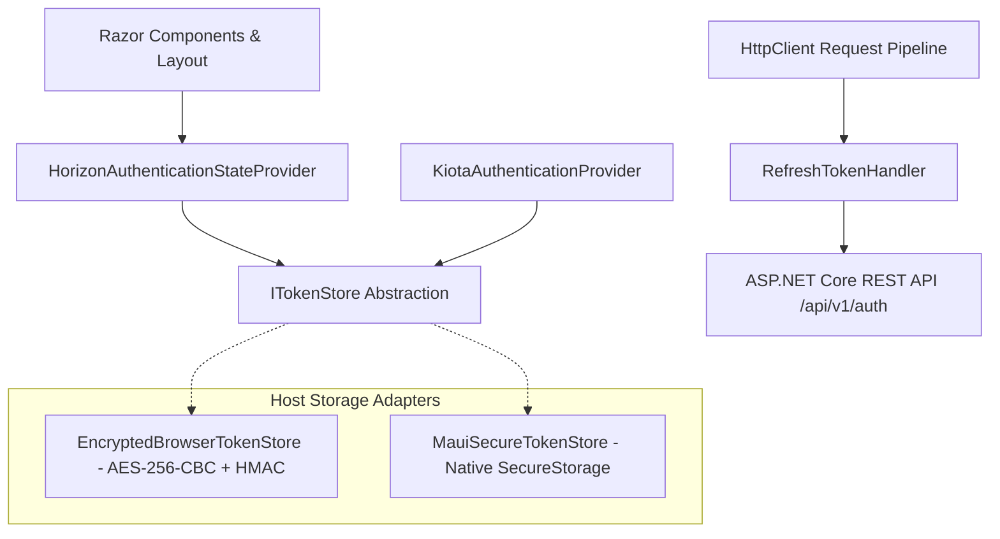

# Client Authentication, Session Management, and Route Protection

This guideline documents the shared authentication and authorization architecture implemented across Horizon Future UI hosts: Blazor WebAssembly (`HF.Web`) and .NET MAUI Blazor Hybrid (`HF.Mobile`).

---

## 1. Architectural Overview



The authentication system is built on native Blazor abstractions (`AuthenticationStateProvider`, `AuthorizeRouteView`, `AuthorizeView`) coupled with persistent, protected token storage and automatic token rotation.

### Core Components in `HF.Shared.Auth`

1. **`ITokenStore`**:
   - Asynchronous contract for getting, saving, and clearing access and refresh tokens.
   - Exposes `event EventHandler? TokensChanged` to notify listeners of any mutation.
2. **`IUserAccessService` & `UserAccessService`**:
   - Thread-safe in-memory cache holding effective `CurrentRoles` and `CurrentPolicies` for the active session.
   - Loads access rules from `GET /api/v1/auth/access` upon login or session restoration.
   - Dispatches `AccessChanged` events and clears cached capabilities when 401 Unauthorized is encountered.
3. **`HorizonAuthenticationStateProvider`**:
   - Inherits native `AuthenticationStateProvider`.
   - Reads the access token from `ITokenStore`, decodes base claims using `JwtParser`, and enriches the principal with effective `ClaimTypes.Role` and `permission` claims supplied by `IUserAccessService`.
   - Reactively listens to both `TokensChanged` and `AccessChanged` to re-evaluate and propagate authentication changes across the entire component tree without requiring a manual page reload.
   - If an access token is expired or expiring within seconds, it attempts proactive refresh via the refresh token before marking the session invalid.
4. **`HorizonAuthorizationPolicyProvider`**:
   - Custom `DefaultAuthorizationPolicyProvider` that automatically synthesizes authorization policies for any policy name (e.g. `[Authorize(Policy = "Enrollments.Read")]`).
   - Evaluates whether the user holds a matching `permission` claim or possesses the `Admin` role, eliminating brittle client-side manual policy duplication.
5. **`JwtParser`**:
   - Lightweight, zero-dependency parser that decodes JWT claims (`sub`, `email`, `role`, `permission`) and expiration (`exp`).
   - Evaluates token expiration with configurable clock-skew buffers.

---

## 2. Route and Navigation Protection

### Route Attributes

Routes are explicitly classified into public and protected components:

- **Public Routes (`[AllowAnonymous]`)**:
  - `/auth/login` (`Login.razor`)
  - `/auth/register` (`Register.razor`)
  - `/auth/forgot-password` (`ForgotPassword.razor`)
  - `/auth/reset-password` (`ResetPassword.razor`)
  - `/auth/confirm-email` (`ConfirmEmail.razor`)
  - `/not-found` (`NotFound.razor`)
- **Protected Routes (`[Authorize]`)**:
  - `/` (`Home.razor`): Opening the application without an active or recoverable session immediately triggers navigation to `/auth/login`.
  - Catalogs and feature data: `/courses/*`, `/subjects/*`, `/students/*`, `/teachers/*`.
  - Identity management: `/auth/manage`, `/auth/manage-roles`, `/auth/manage-permissions`.

### Router Configuration

Both host entry points (`HF.Web/App.razor` and `HF.Mobile/Components/Routes.razor`) configure Blazor's `<AuthorizeRouteView>` wrapped in `<CascadingAuthenticationState>`:

```razor
<CascadingAuthenticationState>
    <Router AppAssembly="@typeof(App).Assembly"
            AdditionalAssemblies="new[] { typeof(MainLayout).Assembly }"
            NotFoundPage="@typeof(NotFound)">
        <Found Context="routeData">
            <AuthorizeRouteView RouteData="@routeData" DefaultLayout="@typeof(MainLayout)">
                <NotAuthorized>
                    <RedirectToLogin />
                </NotAuthorized>
                <Authorizing>
                    <MudProgressLinear Color="Color.Primary" Indeterminate="true" Class="my-4" />
                </Authorizing>
            </AuthorizeRouteView>
            <FocusOnNavigate RouteData="@routeData" Selector="h1" />
        </Found>
    </Router>
</CascadingAuthenticationState>
```

When an unauthenticated user attempts to access any route decorated with `[Authorize]`, Blazor immediately evaluates authorization before the component is initialized, rendering `<NotAuthorized>`. `<RedirectToLogin />` immediately redirects the browser to `/auth/login`, ensuring protected forms and actions are never exposed.

### Diagnosed Login Redirection Issues & Resolved Fixes

During architectural inspection, three distinct root causes were identified that caused valid logins to stick on the login screen or bounce back to `/auth/login`:

1. **Double Submission Race Condition:**
   - *Problem:* `Login.razor` declared both `<MudForm @onsubmit="SubmitAsync">` and `<MudButton ButtonType="ButtonType.Submit" OnClick="SubmitAsync">`. Clicking the submit button fired `SubmitAsync` twice concurrently. Because `LoginPageModel.LoginAsync` lacked a re-entrancy guard, two authentication requests were dispatched to the backend simultaneously.
   - *Fix:* Removed the redundant `OnClick` handler from the submit button (allowing standard form submission semantics) and added re-entrancy protection in `LoginPageModel.LoginAsync`:
     ```csharp
     if (IsBusy) return false;
     ```

2. **Asynchronous Authentication State Race Condition:**
   - *Problem:* Upon login success, `SubmitAsync` immediately called `Navigation.NavigateTo("/courses")`. While `AuthService` saved the tokens to `ITokenStore`, triggering `TokensChanged`, `HorizonAuthenticationStateProvider` dispatches `NotifyAuthenticationStateChanged` asynchronously to Blazor's `CascadingAuthenticationState`. The synchronous navigation occurred before Blazor's cascading parameter updated. Consequently, `AuthorizeRouteView` evaluated the route using the previous unauthenticated state, hit `<NotAuthorized>`, and invoked `<RedirectToLogin />`, bouncing the user back to `/auth/login`.
   - *Fix:* `Login.razor` now explicitly awaits the resolved state before navigating:

     ```csharp
     await AuthStateProvider.GetAuthenticationStateAsync();
     Navigation.NavigateTo(destination);
     ```

3. **Insecure and Circular `ReturnUrl` Loops:**
   - *Problem:* `ReturnUrl` accepted arbitrary query parameter values, which could lead to open redirects or infinite loops if `ReturnUrl` pointed to `/auth/login`.
   - *Fix:* Added `IsSafeLocalUrl(string? url)` validation in `Login.razor` requiring local relative paths starting with `/` (excluding `//` or `/auth/login`), falling back safely to `/courses`. In `RedirectToLogin.razor`, circular returnUrls containing `/auth/login` are stripped before setting the redirect query.

---

### Reactive Menus and Identity Badges

- **`NavMenu.razor`**: Uses `<AuthorizeView>` to conditionally render links.
  - Anonymous users see only public authentication links (Login, Register, Password Recovery).
  - Authenticated users see academic features (Courses, Subjects, Students, Teachers) and account profile.
  - Users with `Admin` or `Manager` roles dynamically see administrative options (Roles and Permissions management).
- **`MainLayout.razor`**: Top AppBar displays the active user's identity and a dedicated Logout button when logged in, or an "Entrar" link when anonymous.

---

## 3. Platform Storage Adapters & Threat Model

`InMemoryTokenStore` is provided in `HF.Shared.Auth` as a safe fallback and unit test fixture. In production applications, host-specific adapters are registered directly in DI to supersede the fallback.

### 1. Blazor WebAssembly (`EncryptedBrowserTokenStore`)

Registered in `HF.Web/Program.cs`:

```csharp
builder.Services.AddScoped<ITokenStore, EncryptedBrowserTokenStore>();
```

- **Mechanism**: Encrypts access and refresh tokens using AES-256-CBC and authenticates the ciphertext using HMAC-SHA256 (Encrypt-then-MAC) before storing them in browser `localStorage`.
- **Security Guarantees**:
  - Tokens are never stored in plaintext in `localStorage` or `sessionStorage`.
  - Protects against passive token harvesting via browser developer tools inspection, simple at-rest scrapers, and accidental disk dumps.
  - Tampering or corruption is detected via HMAC verification; corrupted entries are cleared safely, resetting the session cleanly.
- **Threat Model & Real Limitations**:
  - Client-side encryption whose key or derivation logic resides in the browser runtime **CANNOT protect against Cross-Site Scripting (XSS)**.
  - If malicious script executes within the application's origin, it can invoke the same runtime decryption functions or intercept network requests. Browser storage encryption is not an absolute barrier against hostile in-memory execution.

### 2. .NET MAUI Blazor Hybrid (`MauiSecureTokenStore`)

Registered in `HF.Mobile/MauiProgram.cs`:

```csharp
builder.Services.AddScoped<ITokenStore, MauiSecureTokenStore>();
```

- **Mechanism**: Persists credentials in native OS keystores via `Microsoft.Maui.Storage.SecureStorage`:
  - Android: Android Keystore / EncryptedSharedPreferences.
  - iOS / macOS: Apple Keychain Services.
  - Windows: Windows Credential Manager.
- **Resilience**: If the native keystore is temporarily inaccessible or throws platform exceptions, the adapter maintains an in-memory fallback to avoid crashing the application.

### Data Privacy Guarantee

Tokens are strictly hidden from application UI and logs. All form inputs and profile screens avoid displaying raw access or refresh tokens.

---

## 4. Token Refresh and Rotation Lifecycle

The authentication subsystem implements both **proactive** and **reactive** token renewal using the backend's real endpoint (`POST /api/v1/auth/refresh`).

### 1. Proactive Refresh (`KiotaAuthenticationProvider`)

Before attaching a Bearer token to outgoing REST requests:

- Inspects the access token expiration using `JwtParser.IsExpired(token, TimeSpan.FromSeconds(30))`.
- If the token is about to expire, it acquires a `SemaphoreSlim(1, 1)` lock and renews the token before sending the request.
- The new token pair is written to `ITokenStore`, ensuring subsequent calls use the updated credentials.

### 2. Reactive Refresh (`RefreshTokenHandler`)

If an unexpected `401 Unauthorized` response is returned by the API (due to server-side revocation or clock skew):

1. `RefreshTokenHandler` catches the 401 response.
2. It verifies the request is not an auth endpoint (`/auth/login`, `/auth/refresh`, etc.) to prevent infinite loops.
3. Acquires a shared `SemaphoreSlim(1, 1)` lock:
   - If another concurrent request already completed a refresh while waiting, the handler replays the original request immediately using the new rotated token.
   - Otherwise, it sends `POST /api/v1/auth/refresh` with the current refresh token.
4. On success (`200 OK` with `TokenResponse`):
   - Atomically saves the new `accessToken` and `refreshToken` in `ITokenStore`.
   - Replays the failed request with the new `Authorization: Bearer <token>` header.
5. On definite refresh failure (`401 Unauthorized` from the refresh endpoint):
   - Clears `ITokenStore` via `ClearTokensAsync()`.
   - Triggers `NotifyAuthenticationStateChanged`, transitioning the application to unauthenticated.
   - Blazor's `<AuthorizeRouteView>` automatically redirects the user to `/auth/login`.
6. On network failure (`HttpRequestException`):
   - The session tokens are **preserved** in storage so intermittent network outages do not cause unwarranted logouts.

---

## 5. Automated Testing and Verification

To execute all unit and shared integration tests:

```bash
# Run all shared tests (PageModels, Kiota integration, Route discovery, Auth session)
dotnet test tests/HF.UITests/HF.UITests.csproj --filter "FullyQualifiedName~Shared"

# Run domain and architecture unit tests
dotnet test tests/HF.UnitTests/HF.UnitTests.csproj
```
