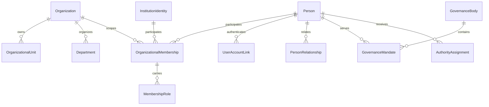

# Organização e stakeholders

## Escopo implementado

O Stage 02 introduz uma identidade reutilizável e separa identidade civil/institucional,
participação na organização, conta autenticada, papel, governança e autoridade.
Uma instalação continua atendendo uma única ONG; `OrganizationId` é escopo organizacional,
não é um mecanismo de multitenancy.

### Glossário

| Conceito | Responsabilidade |
|---|---|
| `Organization` | Identidade institucional da ONG e dona de unidades/departamentos. |
| `OrganizationalUnit` | Unidade operacional hierárquica da organização. |
| `Department` | Área funcional, opcionalmente vinculada a uma unidade. |
| `Person` | Identidade de uma pessoa, sem exigir conta autenticada. |
| `InstitutionIdentity` | Identidade reutilizável de uma instituição externa. |
| `OrganizationalMembership` | Vínculo de uma pessoa/instituição com a organização e seus papéis vigentes. |
| `UserAccountLink` | Ligação explícita e reversível entre identidade e conta do provedor de autenticação. |
| `PersonRelationship` | Relação entre duas pessoas, com vigência. |
| `GovernanceBody` | Órgão estatutário ou de governança. |
| `GovernanceMandate` | Mandato de uma pessoa em um órgão. |
| `AuthorityAssignment` | Responsabilidade ou autoridade formal, distinta de permissão técnica. |
| `IdentityMerge` | Registro auditável de consolidação autorizada de uma identidade de origem em outra. |

## Diagrama de relacionamento

## Limites de agregados

- `Organization` controla suas unidades e departamentos; unidades não são tenants.
- `Person`, `InstitutionIdentity`, `OrganizationalMembership`, `PersonRelationship`,
  `GovernanceMandate`, `AuthorityAssignment` e `IdentityMerge` são raízes independentes
  porque possuem ciclos de vida e invariantes próprios.
- Papéis são itens de `OrganizationalMembership`, com intervalos de vigência e sem duplicação
  de dados civis.
- `UserAccountLink` não referencia `Microsoft.AspNetCore.Identity` no Domain.

## Regras de identidade e merge

- Nome sozinho nunca produz correspondência automática.
- A comparação é determinística e retorna sinais (`normalized_name`, `date_of_birth`,
  `normalized_document`) para revisão manual.
- Documento normalizado combinado com nome ou data de nascimento é uma correspondência exata;
  dois sinais sem documento produzem apenas uma possível duplicidade.
- `IdentityMerge` exige proposta, aprovação e conclusão; fonte e destino, motivo e timestamps
  permanecem preservados, incluindo os operadores de aprovação, conclusão ou rejeição. Um merge
  concluído não pode ser rejeitado ou repetido.
- A implementação não apaga registros referenciados. A migração de referências para o destino
  deve ocorrer em uma transação de aplicação/persistência autorizada.

## Estabilização

- A hierarquia de unidades é alterada somente por `Organization.MoveUnit`, que rejeita
  autorreferência, unidade externa e ciclos indiretos.
- Nomes de unidades e departamentos são comparados com espaços normalizados dentro do escopo da
  organização; a mesma regra não impõe unicidade entre organizações.
- Unidades com subordinadas ativas não podem ser arquivadas, e a operação é exposta pelo
  agregado `Organization`; unidades e departamentos não oferecem mutações públicas que
  contornem a unicidade ou os guardas de ciclo de vida. Departamentos arquivados não podem ser
  arquivados novamente, enquanto operações em memberships, relacionamentos, mandatos e
  autoridades encerrados são rejeitadas.
- O encerramento de uma membership anterior ao início de um papel é rejeitado. Papéis já
  encerrados preservam seu intervalo histórico; somente papéis ainda abertos são encerrados
  com a membership.
- `MembershipScope` carrega a organização e a unidade do departamento para que alterações de
  escopo rejeitem combinações incompatíveis antes da persistência. Departamentos sem unidade
  exigem confirmação explícita, e departamentos vinculados exigem a unidade correspondente;
  omitir essa informação é inválido.
- A criação de `OrganizationalMembership` recebe um `MembershipScope` estruturalmente válido;
  criação e alteração de escopo usam o mesmo contrato. A Application resolve as referências
  organizacionais antes de construir o escopo, enquanto o Domain valida apenas a coerência
  estrutural transportada pelo contrato.
- Unidades arquivadas não podem receber novas unidades subordinadas, ser usadas como unidade de
  departamento ou receber movimentações. Organizações arquivadas não podem ser arquivadas
  novamente.
- Identidades podem ser reativadas explicitamente. Atualizações de identidades arquivadas são
  rejeitadas.
- A normalização de matching remove marcas Unicode, normaliza caixa e espaços, e nunca classifica
  nomes iguais isoladamente como correspondência exata.

## Validação externa

Os testes backend deste estágio devem ser executados fora da sandbox. A validação registrada usa
o projeto `tests\HF.UnitTests\HF.UnitTests.csproj`, sem executar UI porque não há interface de
produto neste estágio. A execução deve registrar SDK, comando exato e totais literais; testes de
Razor/rotas permanecem separados em `HF.UITests`.

## Privacidade e ciclo de vida

- `Person` armazena somente nome, nome social opcional e data de nascimento opcional neste estágio.
- Dados médicos, avaliações sociais e consentimento legal não foram transferidos para o novo núcleo.
- Identidades, unidades, memberships e mandatos são arquivados/encerrados; exclusão destrutiva
  não é o fluxo do domínio.
- Datas de conta e merge são UTC; períodos de vínculo, mandato e autoridade usam `DateOnly`.

## Compatibilidade do modelo educacional

`Student`, `Teacher`, `Volunteer`, `Collaborator`, `Director` e `Manager` continuam sendo
registros operacionais específicos dos fluxos educacionais existentes. Cada um agora possui
`PersonId` opcional para apontar para a identidade canônica; `UserId` permanece como ligação de
compatibilidade com a autenticação existente, não como identidade civil. Novos fluxos devem
criar a identidade e o membership primeiro e preencher a referência de papel, evitando copiar
nome e dados pessoais para tabelas de papel.

Essa ponte preserva matrículas, frequência, cursos e atribuições docentes durante a migração de
dados legados. Os campos específicos de ensino, contrato, mandato ou disponibilidade continuam
nos registros operacionais porque não são atributos da identidade.

## Escopo de acesso

| Operação | Escopo esperado |
|---|---|
| Identidade e membership | Usuários autorizados na organização e, quando aplicável, na unidade/departamento. |
| Dados de contato e documentos | Acesso restrito por finalidade e permissão; não são retornados por padrão. |
| Governança e autoridade | Administração autorizada da organização; autoridade formal não concede permissão técnica automaticamente. |
| Merge | Revisão manual e autorização explícita; não há merge por nome. |

Autorizações HTTP detalhadas permanecem na camada API e devem revalidar membership e escopo
antes de cada operação.
