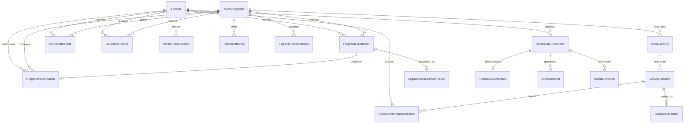
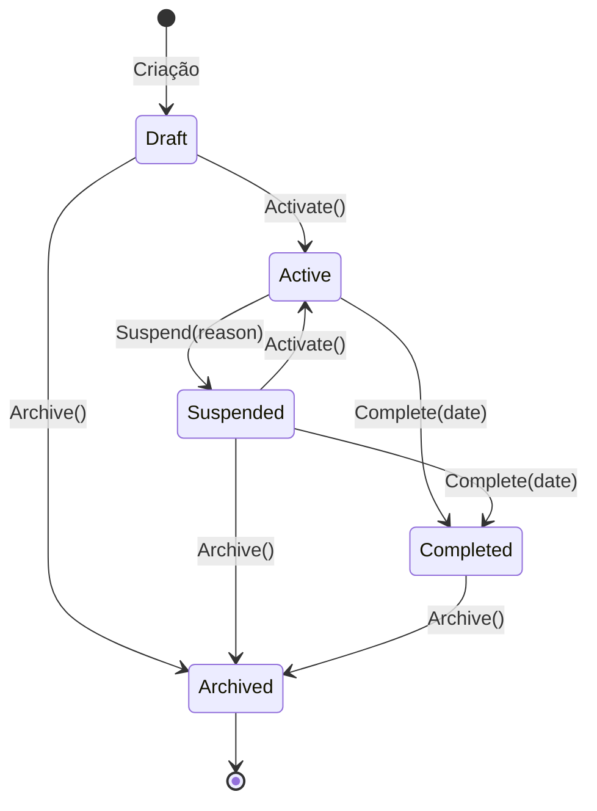
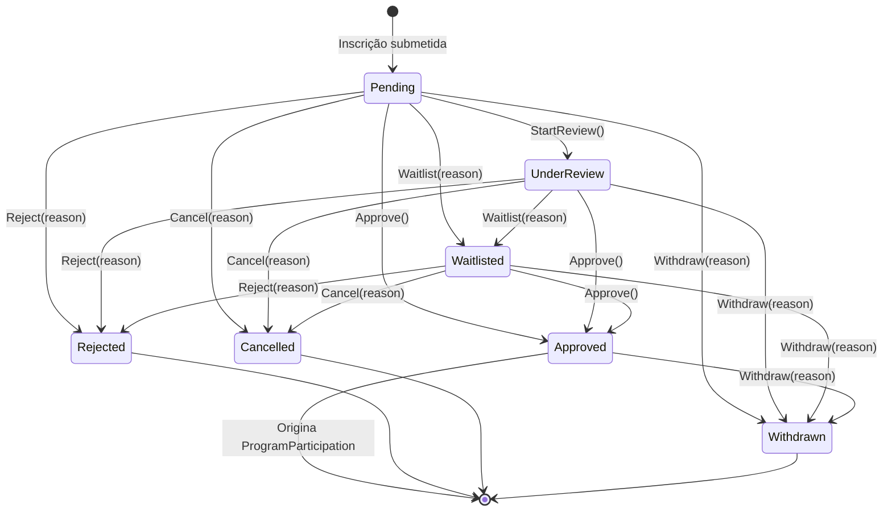
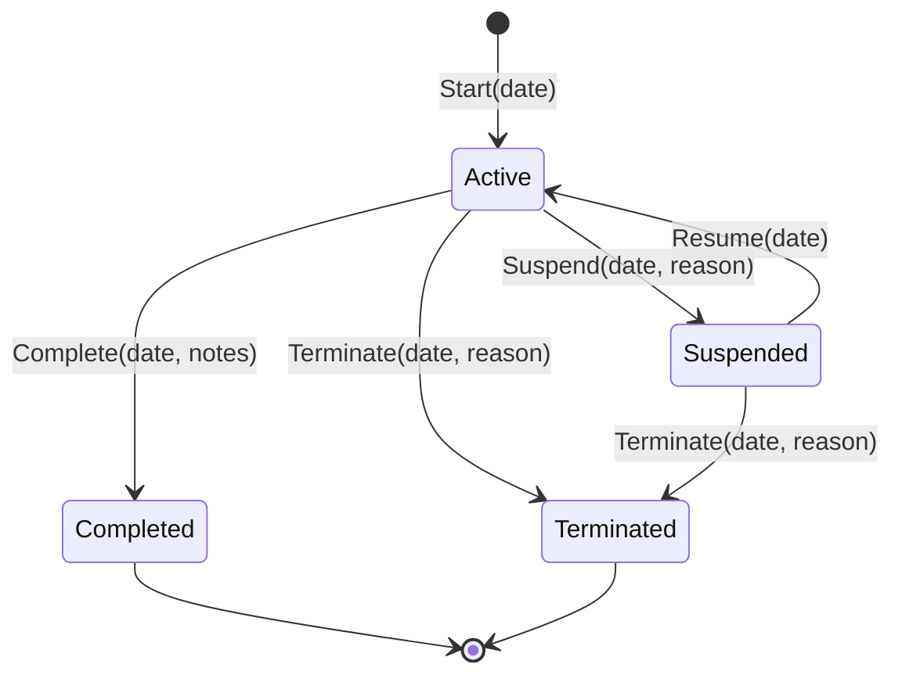
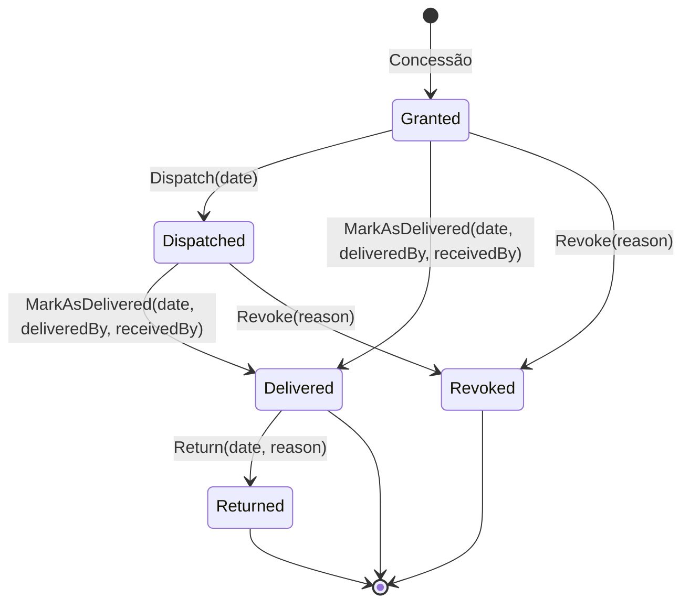

# Atendimento e Serviços Sociais (Social Service Delivery)

## Escopo implementado

O Stage 03 implementa o domínio responsável por representar a operação de atendimento e serviços sociais de uma organização da sociedade civil (ONG/OSC).

Uma instalação do HorizonFuture atende a uma única ONG; os identificadores organizacionais (`OrganizationId`, `OrganizationalUnitId`, `DepartmentId`) definem escopos operacionais e locais de atendimento, sem introduzir mecanismos de multitenancy.

O domínio reutiliza a identidade canônica `HF.Domain.Stakeholders.Person`. Um beneficiário é qualquer pessoa que participa de programas ou recebe atendimentos, sem duplicação de dados civis ou de contato.

A participação em programas sociais e as matrículas/inscrições possuem ciclo de vida próprio e **não se confundem com `OrganizationalMembership`** (vínculo institucional com a ONG).

---

## Glossário do domínio

| Conceito | Tipo de componente | Responsabilidade |
|---|---|---|
| `SocialProgram` | Agregado (`AggregateRoot`) | Iniciativa continuada destinada a determinado público ou finalidade social, com critérios e linhas de atendimento. |
| `OperatingPeriod` | Objeto de Valor (`ValueObject`) | Período de vigência operacional do programa (`StartDate`, `EndDate`). |
| `ServiceOffering` | Entidade (`EntityBase`) | Linha de atendimento ou serviço ofertado no âmbito de um programa. |
| `IEligibilityCriterion` / `EligibilityCriterionBase` | Objeto de Valor (`ValueObject`) | Requisitos verificáveis para ingresso no programa (faixa etária, território, grupo-alvo, documentos, atributos). |
| `ApplicantProfile` | Objeto de Valor (`ValueObject`) | Perfil de dados declarados e comprovados do candidato para avaliação de elegibilidade. |
| `EligibilityAssessmentResult` | Objeto de Valor (`ValueObject`) | Resultado técnico da verificação dos critérios de elegibilidade. |
| `ProgramEnrollment` | Agregado (`AggregateRoot`) | Solicitação formal de ingresso em um programa, avaliação e decisão administrativa. |
| `ProgramParticipation` | Agregado (`AggregateRoot`) | Participação ativa e contínua do beneficiário no programa, com histórico de transições. |
| `ParticipationHistoryEntry` | Objeto de Valor (`ValueObject`) | Registro histórico imutável de transição de estado da participação (`TransitionDate`, `Reason`, `ChangedBy`). |
| `SocialCareEncounter` | Agregado (`AggregateRoot`) | Interação de atendimento individual, familiar ou domiciliar realizada por equipe técnica. |
| `SensitiveCareNotes` | Objeto de Valor (`ValueObject`) | Anotações operacionais sensíveis com finalidade legítima declarada e restrição de acesso. |
| `DeliveredService` | Agregado (`AggregateRoot`) | Registro de serviço executado ou agendado em favor de um beneficiário. |
| `DeliveredBenefit` | Agregado (`AggregateRoot`) | Benefício eventual ou continuado (alimentos, kit escolar, vestuário) concedido e entregue. |
| `BenefitQuantity` | Objeto de Valor (`ValueObject`) | Quantidade positiva e unidade de medida do benefício concedido. |
| `SocialReferral` | Agregado (`AggregateRoot`) | Encaminhamento para a rede socioassistencial externa (CRAS, CREAS, UBS) ou interna. |
| `SocialActivity` | Agregado (`AggregateRoot`) | Atividade regular desenvolvida no escopo de um programa. |
| `ActivitySession` | Agregado (`AggregateRoot`) | Ocorrência concreta (sessão/encontro) com horários, facilitadores e lista de presença. |
| `SessionAttendanceRecord` | Objeto de Valor (`ValueObject`) | Registro de presença ou ausência (com justificativa obrigatória se justificada). |
| `SocialEvidence` | Agregado (`AggregateRoot`) | Metadados e referências abstratas a documentos, termos assinados ou fotos de comprovação. |

---

## Diagrama de relacionamentos

---

## Limites de agregados e invariantes

### 1. `SocialProgram`
- **Ciclo de vida:** `Draft` -> `Active` <-> `Suspended` -> `Completed` / `Archived`.
- **Inscrições:** Um programa só pode aceitar novas inscrições se seu estado for estritamente `Active`.
- **Suspensão:** Requer motivo não vazio. Não pode suspender programas em `Draft`, `Completed` ou `Archived`.
- **Conclusão:** Data de encerramento não pode ser anterior à data de início das operações.
- **Imutabilidade:** Programas arquivados ou concluídos rejeitam adições de critérios, ofertas ou edições cadastrais.

### 2. `ProgramEnrollment` vs `OrganizationalMembership`
- Inscrição em programa social representa a formalização de demanda e triagem para um serviço específico.
- É independente do vínculo institucional `OrganizationalMembership`. Uma pessoa pode ser membro da ONG sem estar inscrita em programas sociais, ou participar de vários programas sem ser associada ou colaboradora.
- **Ciclo de vida:** `Pending` -> `UnderReview` -> `Approved` / `Waitlisted` / `Rejected` / `Cancelled` / `Withdrawn`.
- **Aprovação:** Somente permitida se o programa estiver `Active`. Inscrições em estados terminais (`Rejected`, `Cancelled`, `Withdrawn`) rejeitam transições.
- **Motivo obrigatório:** Rejeição, cancelamento, lista de espera e desistência exigem justificativa explícita.
- **Participação:** Inscrições aprovadas podem originar uma `ProgramParticipation`.

### 3. `ProgramParticipation`
- Representa o vínculo fático e contínuo do beneficiário no programa.
- **Ciclo de vida:** `Active` <-> `Suspended` -> `Completed` / `Terminated`.
- **Histórico:** Cada mudança de estado registra uma entrada imutável em `History` (`ParticipationHistoryEntry`) com data, motivo e responsável.
- **Cronologia:** Nenhuma transição pode ter data anterior ao início da participação nem anterior à última transição registrada.

### 4. `SocialCareEncounter` (Atendimentos)
- Atendimento individual, familiar, visita domiciliar ou triagem.
- **Não é prontuário médico:** Não registra diagnósticos clínicos (CID), prescrições de remédios ou laudos médicos.
- **Notas sensíveis (`SensitiveCareNotes`):** Exigem finalidade operacional legítima declarada e classificação de confidencialidade.
- **Conclusão:** A data/hora de atendimento não pode ser futura. Resumo operacional é obrigatório.

### 5. `DeliveredBenefit` e `DeliveredService`
- Diferenciação rigorosa:
  - Serviço agendado vs serviço prestado.
  - Benefício concedido (`Granted`) vs benefício entregue (`Delivered`).
- **Quantidade:** O objeto de valor `BenefitQuantity` exige valor estritamente positivo (`> 0`) e unidade de medida.
- **Entrega:** Requer data válida (não anterior à concessão), responsável pela entrega e recebedor (que pode ser o beneficiário ou seu responsável legal via `PersonRelationship`).
- **Rastreabilidade contábil futura:** Preserva propriedades `ProjectId` e `FundingSourceId` para vinculação nos Stages 04 e 05.

### 6. `SocialReferral` (Encaminhamentos)
- Encaminhamento interno ou externo (CRAS, CREAS, Conselho Tutelar, Posto de Saúde, Defensoria).
- **Distinção de serviço:** Um encaminhamento externo **não é um serviço executado pela ONG**. O ciclo só atinge `Completed` quando a instituição de destino confirmar o acolhimento/resultado.

### 7. `SocialActivity` e `ActivitySession`
- Atividades agrupam encontros e sessões.
- **Sessão:** Possui horários de início e término (`ScheduledEnd >= ScheduledStart`), local e lista de facilitadores.
- **Frequência:** Estados: `Present`, `Absent`, `JustifiedAbsence`, `Excused`, `NotRecorded`.
- **Invariante de Justificativa:** Ausência justificada (`JustifiedAbsence`) exige obrigatoriamente motivo/justificativa.
- **Sessão Cancelada:** Rejeita qualquer registro de presença.
- **Duplicidade:** Rejeita registro de presença duplicado para a mesma pessoa na mesma sessão.

### 8. `SocialEvidence`
- Armazena exclusivamente **metadados e URIs lógicas**.
- Nenhuma entidade de domínio armazena arrays de bytes de imagens ou arquivos.
- Classificação de sensibilidade: `Standard`, `Confidential`, `Restricted`.

---

## Máquinas de estado

### Ciclo de vida do programa social (`SocialProgram`)

### Ciclo de vida da inscrição (`ProgramEnrollment`)

### Ciclo de vida da participação (`ProgramParticipation`)

### Ciclo de vida do benefício entregue (`DeliveredBenefit`)

---

## Privacidade e proteção de dados (Privacy-by-Design)

1. **Minimização de dados:**
   - O domínio não armazena dados de saúde, religião, biometria ou opiniões políticas em campos genéricos.
   - O atendimento social foca nas necessidades operacionais e de vulnerabilidade socioassistencial.
2. **Segregação de notas sensíveis:**
   - `SensitiveCareNotes` é um objeto de valor encapsulado que exige finalidade operacional declarada para existir.
   - Não é exposto em relatórios operacionais gerais ou dashboards públicos.
3. **Parentesco e Acesso:**
   - A existência de um vínculo familiar (`PersonRelationship`) não presume autorização tácita para acesso a dados pessoais ou retiradas de benefícios sem autorização explícita ou guarda legal comprovada (`PersonRelationshipType.LegalGuardian`).
4. **Isolamento de mídia:**
   - Fotos e comprovantes residirão em storage seguro fora do banco relacional, rastreados por `SocialEvidence` com classificação de confidencialidade.
5. **Dados sintéticos:**
   - Todos os testes unitários e documentação usam dados fictícios gerados artificialmente.

---

## Hipóteses e pontos para validação externa posterior

As regras a seguir foram implementadas como hipóteses operacionais sólidas e configuráveis, com validação empírica prevista junto à ONG piloto após a primeira release estável:
1. **Regra de lista de espera:** Inscrições em lista de espera podem ser promovidas diretamente para aprovação assim que uma vaga for liberada pela equipe social.
2. **Entrega de benefícios a representantes:** Benefícios destinados a menores de idade podem ser entregues a guardiões legais registrados via `PersonRelationship`.
3. **Ausência justificada:** Atestados médicos ou declarações escolares comprovam ausência justificada na sessão de atividades e não penalizam a frequência do participante.
4. **Encaminhamentos externos:** O encerramento de um encaminhamento externo depende de retorno formal da entidade de destino (ex: CRAS/CREAS), permanecendo `Dispatched` ou `Acknowledged` até confirmação.
