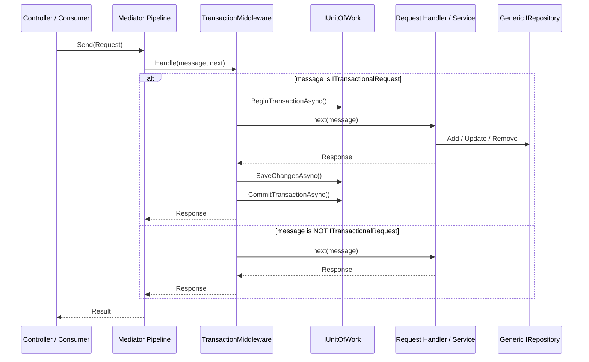

# Transactional Mediator Requests Pattern

## Overview

In the *Horizon – Olhar do Futuro* architecture, the application layer uses Mediator for request handling, while the infrastructure layer coordinates database operations through Entity Framework Core and PostgreSQL.

To guarantee atomicity and database consistency without scattering transaction management logic across application services, a centralized pipeline behavior is used: `TransactionMiddleware<TMessage, TResponse>`.



---

## 1. Marker Interface: `ITransactionalRequest`

Located at:
`src/HF.Application/Common/Abstractions/Repositories/ITransactionalRequest.cs`

```csharp
namespace HF.Application.Common.Abstractions.Repositories;

/// <summary>
/// Marker interface for Mediator requests that require an explicit database transaction.
/// </summary>
public interface ITransactionalRequest { }
```

Requests implement this interface alongside `IRequest<TResponse>`:

```csharp
public sealed record CreateStudentRequest(...)
    : IRequest<ResponseBase<StudentResponse>>, ITransactionalRequest;
```

---

## 2. Classification Criteria

### A. Requests Marked as Transactional (`ITransactionalRequest`)

Every Mediator request in `HF.Application` that represents a command and whose handler/service executes write operations (`insert`, `update`, or `delete`) via the generic repository (`IRepository<TEntity>`) **must** implement `ITransactionalRequest`.

This applies regardless of whether the request name starts with `Create`, `Update`, or `Delete`. What dictates the classification is the actual behavioral effect on persistence:
- **AssetsLiabilities**: `CreateAssetRequest`, `UpdateAssetRequest`, `DeleteAssetRequest`, `CreateLiabilityRequest`, `UpdateLiabilityRequest`, `DeleteLiabilityRequest`
- **Attendances**: `CreateAttendanceRequest`, `UpdateAttendanceRequest`, `DeleteAttendanceRequest`
- **ClassSessions**: `CreateClassSessionRequest`, `UpdateClassSessionRequest`, `DeleteClassSessionRequest`
- **Collaborators**: `CreateCollaboratorRequest`, `UpdateCollaboratorRequest`, `DeleteCollaboratorRequest`
- **Courses**: `CreateCourseRequest`, `UpdateCourseRequest`, `DeleteCourseRequest`, `CreateSubjectRequest`, `UpdateSubjectRequest`, `DeleteSubjectRequest`
- **Directors**: `CreateDirectorRequest`, `UpdateDirectorRequest`, `DeleteDirectorRequest`
- **Enrollments**: `CreateEnrollmentRequest`, `UpdateEnrollmentRequest`, `DeleteEnrollmentRequest`
- **Managers**: `CreateManagerRequest`, `UpdateManagerRequest`, `DeleteManagerRequest`
- **Students**: `CreateStudentRequest`, `UpdateStudentRequest`, `DeleteStudentRequest`
- **TeacherAssignments**: `CreateTeacherAssignmentRequest`, `UpdateTeacherAssignmentRequest`, `DeleteTeacherAssignmentRequest`
- **Teachers**: `CreateTeacherRequest`, `UpdateTeacherRequest`, `DeleteTeacherRequest`
- **Volunteers**: `CreateVolunteerRequest`, `UpdateVolunteerRequest`, `DeleteVolunteerRequest`

Total: 42 commands across 14 entities.

### B. Read Queries Excluded

Queries (e.g., `Get*ByIdRequest`, `List*Request`) only perform non-mutating reads. They **must not** implement `ITransactionalRequest`. Opening a transaction for read queries causes unnecessary database locks, connection pool contention, and overhead.

### C. Authentication Feature Excluded

All requests in `HF.Application.Auth.Requests` (including identity admin requests) **must not** implement `ITransactionalRequest`. These commands operate via ASP.NET Core Identity (`UserManager<ApplicationUser>`, `SignInManager<ApplicationUser>`, `RoleManager<ApplicationRole>`) and memory stores. They do not utilize `IRepository<T>` and manage their own internal persistence lifecycle.

---

## 3. Middleware Implementation & DI Registration

### Middleware Behavior

`src/HF.Infrastructure/Persistence/Middlewares/TransactionMiddleware.cs`:

- If `message is not ITransactionalRequest`: skips transaction and delegates directly to `next()`.
- If `message is ITransactionalRequest`:
  1. Calls `unitOfWork.BeginTransactionAsync(cancellationToken)`.
  2. Executes `await next(message, cancellationToken)`.
  3. Calls `unitOfWork.SaveChangesAsync(cancellationToken)`.
  4. Calls `unitOfWork.CommitTransactionAsync(cancellationToken)`.
  5. If an exception occurs, calls `unitOfWork.RollbackTransactionAsync(CancellationToken.None)` and rethrows.

### Pipeline Configuration

In `src/HF.Composition/Extensions/ServiceCollectionExtensions.cs`:

```csharp
services.AddMediator(options =>
{
    options.ServiceLifetime = ServiceLifetime.Scoped;
    options.Assemblies = [typeof(Application.Auth.Handlers.AuthHandlers).Assembly];
    options.PipelineBehaviors =
    [
        typeof(LoggingMiddleware<,>),
        typeof(ValidationMiddleware<,>),
        typeof(TransactionMiddleware<,>)
    ];
});
```

The transaction remains strictly centralized in this pipeline behavior. Neither `IRepository<T>` nor application handlers start independent transactions, ensuring all repository operations participate cleanly in the `IUnitOfWork` transaction boundary.

---

## 4. Verification

Architecture and unit test suites enforce these invariants:

1. `tests/HF.UnitTests/Persistence/TransactionalRequestsArchitectureTests.cs`:
   - Reflection asserts that all 42 non-Auth write commands implement `ITransactionalRequest`.
   - Reflection asserts that queries do not implement `ITransactionalRequest`.
   - Reflection asserts that Auth requests do not implement `ITransactionalRequest`.
2. `tests/HF.UnitTests/Persistence/TransactionMiddlewareTests.cs`:
   - Verifies transactional messages execute inside `BeginTransactionAsync`, `SaveChangesAsync`, and `CommitTransactionAsync`.
   - Verifies non-transactional messages bypass transaction opening.
   - Verifies exceptions trigger `RollbackTransactionAsync`.
   - Verifies DI registration in `AddApplication()`.

