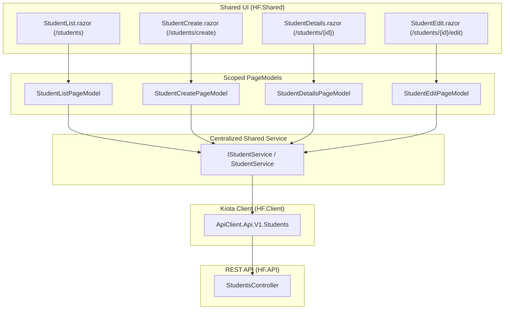

# Traceability and UI Coverage Matrix - Students Feature

This document provides the endpoint-by-endpoint traceability matrix and architectural coverage for the **Students** feature in *Horizon – Olhar do Futuro*, adhering to offline-first and single-tenant NGO architecture, centralized Kiota REST consumption (`HF.Client`), MVVM PageModel decoupling (`HF.Shared`), MudBlazor design guidelines, accessibility, keyboard navigation, and cross-platform support across Blazor WebAssembly (`HF.Web`) and .NET MAUI Blazor Hybrid (`HF.Mobile`).

---

## 1. Students Feature Traceability Matrix

Controller: `src/HF.API/Controllers/v1/StudentsController.cs`

| # | HTTP Method & Route | Authorization Policy | Request Payload / Query | Response / Status Codes | Shared UI Page & Action | Scoped PageModel | Centralized Service | Kiota Operation | Coverage Status |
|---|---|---|---|---|---|---|---|---|---|
| 1 | `GET /api/v1/students` | `[Authorize(StudentsRead)]` | Query: `schoolUnitId` (string?), `status` (StudentStatus?) | `200 OK` (`IReadOnlyList<StudentResponse>`), `401 Unauthorized`, `403 Forbidden` | `StudentList.razor` Filter inputs and table load | `StudentListPageModel.LoadStudentsAsync()` | `IStudentService.ListAsync(filter, ct)` | `ApiClient.Api.V1.Students.GetAsync(...)` | **Covered & Verified** |
| 2 | `GET /api/v1/students/{id}` | `[Authorize(StudentsRead)]` | Route: `id` (string) | `200 OK` (`StudentResponse`), `401 Unauthorized`, `403 Forbidden`, `404 NotFound` | `StudentDetails.razor` `StudentEdit.razor` | `StudentDetailsPageModel.LoadStudentAsync(id)` `StudentEditPageModel.LoadStudentAsync(id)` | `IStudentService.GetByIdAsync(id, ct)` | `ApiClient.Api.V1.Students[id].GetAsync(...)` | **Covered & Verified** |
| 3 | `POST /api/v1/students` | `[Authorize(StudentsCreate)]` | Body: `CreateStudentRequest` (`UserId`, `RegistrationNumber`, `DateOfBirth`, `GuardianName`, `GuardianRelationship`, `GuardianPhone`, `EmergencyContactName`, `EmergencyContactPhone`, `SchoolUnitId`, `Status`, `SpecialNeeds`, `MedicalNotes`, `EnrollmentDate`) | `201 Created` (`StudentResponse`), `400 BadRequest`, `401 Unauthorized`, `403 Forbidden`, `422 UnprocessableEntity` | `StudentCreate.razor` Form submission with validation | `StudentCreatePageModel.CreateStudentAsync()` | `IStudentService.CreateAsync(request, ct)` | `ApiClient.Api.V1.Students.PostAsync(...)` | **Covered & Verified** |
| 4 | `PUT /api/v1/students/{id}` | `[Authorize(StudentsUpdate)]` | Route: `id` (string) Body: `UpdateStudentRequest` (`Id`, `RegistrationNumber`, `DateOfBirth`, `GuardianName`, `GuardianRelationship`, `GuardianPhone`, `EmergencyContactName`, `EmergencyContactPhone`, `SchoolUnitId`, `Status`, `SpecialNeeds`, `MedicalNotes`) | `200 OK` (`StudentResponse`), `400 BadRequest`, `401 Unauthorized`, `403 Forbidden`, `404 NotFound`, `422 UnprocessableEntity` | `StudentEdit.razor` Form edit and save with validation | `StudentEditPageModel.SaveStudentAsync()` | `IStudentService.UpdateAsync(request, ct)` | `ApiClient.Api.V1.Students[id].PutAsync(...)` | **Covered & Verified** |
| 5 | `DELETE /api/v1/students/{id}` | `[Authorize(StudentsDelete)]` | Route: `id` (string) | `204 NoContent`, `401 Unauthorized`, `403 Forbidden`, `404 NotFound`, `409 Conflict` | `StudentDetails.razor` `StudentList.razor` Destructive confirmation dialog | `StudentDetailsPageModel.DeleteStudentAsync()` `StudentListPageModel.DeleteStudentAsync(id)` | `IStudentService.DeleteAsync(id, ct)` | `ApiClient.Api.V1.Students[id].DeleteAsync(...)` | **Covered & Verified** |

---

## 2. Architecture & Data Flow

### Key Architectural Invariants

1. **Host Reusability**: All student pages and components reside in `HF.Shared` and are consumed without modification by both `HF.Web` (Blazor WebAssembly) and `HF.Mobile` (.NET MAUI Blazor Hybrid).
2. **Dedicated PageModels**: Each view possesses its own PageModel inheriting from `PageModelBase`, maintaining independent state machines (Loading, Error, Forbidden, Unauthorized, Conflict, Not Found).
3. **No Direct HTTP Calls**: Pages and PageModels strictly depend on `IStudentService`, never directly manipulating `HttpClient`, formatting query strings, or parsing JSON responses.
4. **Sensitive Data Protection**: Student personal and medical information (`GuardianName`, `GuardianPhone`, `SpecialNeeds`, `MedicalNotes`) is treated as sensitive. Automated tests exclusively use synthetic test data; no actual student PII or health data is ever committed to source, logs, or test reports.
5. **Conflict Handling**: When a student deletion is rejected due to active enrollments (`409 Conflict`), the UI explicitly surfaces the business cause instead of displaying a generic failure.

---

## 3. Test Coverage Summary

| Test Suite | Location | Covered Capabilities | Test Count | Status |
|---|---|---|:---:|:---:|
| **Shared Student PageModels** | `tests/HF.UITests/Shared/SharedStudentsPageModelsTests.cs` | Initial states, loading, empty collections, validation failures, exceeding length, API errors, 401/403/409, reset, filter logic, double-submission guards | 32 | Passed |
| **Shared Student Kiota Integration** | `tests/HF.UITests/Shared/SharedStudentsKiotaIntegrationTests.cs` | GET list with query filters, GET by ID, POST create with date serialization, PUT update, DELETE, 400/401/403/404/409/422 status mapping | 15 | Passed |
| **Shared Discovery & DI** | `tests/HF.UITests/Shared/SharedStudentsRouteAndComponentDiscoveryTests.cs` | Route attribute discovery, `@attribute [Authorize]`, DI registration in `AddPageModels()` | 4 | Passed |
| **Domain Student Service** | `tests/HF.UnitTests/Students/StudentServiceTests.cs` | Business rules, persistence via generic repository, uniqueness checks, enrollment deletion constraint | 9 | Passed |
| **Web Selenium Automation** | `tests/HF.UITests/Web/WebStudentsFlowUITests.cs` | Real browser execution: unauthorized state, list navigation, validation and form submission, not found card, end-to-end CRUD | 5 | Passed / Automated |
| **Mobile Appium Automation** | `tests/HF.UITests/Mobile/MobileStudentsFlowUITests.cs` | BlazorWebView container inspection, mobile table viewport, touch form elements, metadata cards | 3 | Automated |

